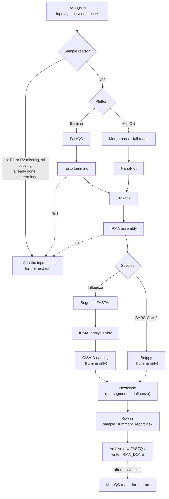

# IRMA Pipeline Runner

A pipeline for influenza and SARS-CoV-2 sequencing data from Illumina
(NextSeq / MiSeq) and Oxford Nanopore MinION runs. It runs read QC,
taxonomic classification, assembly with IRMA, clade assignment and GISAID
naming, and writes Excel/HTML summary reports.

| Species | NextSeq | MiSeq | MinION |
|---|---|---|---|
| Influenza (`influenza/`) | ✅ | ✅ | ✅ (no GISAID naming) |
| SARS-CoV-2 (`covid/`) | ✅ | ✅ | ✅ (no Snippy) |

**More documentation**

| | |
|---|---|
| [docs/configuration.md](docs/configuration.md) | Every `config.json` key, IRMA external configs, Nextclade datasets |
| [docs/input_layout.md](docs/input_layout.md) | Input folders, sample naming, MinION runs || [docs/outputs.md](docs/outputs.md) | Every result file, logs, reading the Nextclade TSVs |
| [docs/irma-naming.md](docs/irma_naming.md) | How IRMA names consensus files and why `SEG_NUMBERS` is set twice |
| [docs/adding-a-species.md](docs/adding_species.md) | Adding a virus (e.g. RSV) or a sequencer |
| [CONTRIBUTING.md](./docs/contributing.md) | Tests, linting, code layout |
| [CHANGELOG.md](docs/changelog.md) | What changed and when |
| Gitea wiki | Running the watcher on the server, design decisions |

## Pipeline steps



Steps with a thick border are required: if they fail, the sample stops and
its raw files stay in place. All other tools are optional and are skipped
with a warning if their conda environment is not configured.

1. **Checks** – files no longer growing; for Illumina, both R1 and R2 present.
2. **Pre-processing**
   - Illumina: `FastQC` (raw reads), `fastp` (trimming), `Kraken2` (trimmed pairs).
   - MinION: all of a barcode's reads (`fastq_pass` **and** `fastq_fail`)
     merged into `<sample>.fastq.gz`, `NanoPlot`, `Kraken2`. No trimming.
3. **Assembly** – `IRMA` (`FLU` / `CoV` for Illumina, `FLU-minion` /
   `CoV-minion-long-reads` for MinION), plus `Snippy` for Illumina SARS-CoV-2.
4. **Post-processing**
   - Influenza: consensus per segment, `IRMA_analysis.xlsx` (N% per segment,
     read counts), GISAID naming (Illumina only), `Nextclade` per segment
     (A/H1, A/H2, A/H3 and B datasets).
   - SARS-CoV-2: `Nextclade` on the consensus genome.
   - All: `sample_summary_report.xlsx` (Kraken2 top hit, ambiguous sites, N%,
     mean coverage) and one `MultiQC` report per run.
5. **Finish** – raw FASTQs moved to `archive_dir`, sample marked done.

## Requirements

- Python 3.11+ (developed on 3.13) and [uv](https://docs.astral.sh/uv/)
- conda, with each tool in its own environment (fastp, FastQC, Kraken2, IRMA,
  Snippy, Nextclade, MultiQC; NanoPlot for MinION)
- Reference data: a Kraken2 database, the SARS-CoV-2 reference (`.gbk`) for
  Snippy, and Nextclade datasets
  ([naming rules](docs/configuration.md#nextclade-datasets))

## Installation

```bash
git clone <repository_url>
cd irma_pipe
uv sync          # Python dependencies (+ pytest and ruff for development)

for env_file in conda_envs/*.yml; do conda env create -f "$env_file"; done
```

## Configuration

```bash
cp config.example.json config.json
```

Then edit the paths and conda environment names in `config.json`. The
minimum to run is:

```json
{
    "fastp_conda_env": "qc",
    "irma_conda_env": "irma_env",
    "logs_dir": "/mnt/volume/logs",
    "archive_dir": "/mnt/volume/storage"
}
```

`fastp_conda_env` (Illumina) and `irma_conda_env` are required: if either is
missing the sample stops and its raw files stay in place. Every other tool is
optional: if its key is missing, that step is skipped with a warning. All keys
and defaults are listed in [docs/configuration.md](docs/configuration.md).

Check that `TMP` in `custom-config.sh` and `custom-config-flu.sh` points at a
folder that exists on your server.

> ⚠️ **After upgrading IRMA**, check that `custom-config-flu.sh` still contains
> the lab's `SEG_NUMBERS` line. Without it, influenza consensus files get
> IRMA's stock names. See [docs/irma-naming.md](docs/irma-naming.md).

## Input layout

```
<input_dir>/<influenza|covid>/<nextseq|miseq|minion>/.../<sample>_R1.fastq.gz
```

The first two folders tell the pipeline the species and sequencer. Below
them, any layout works: copy one folder per sample, or just the FASTQs.

```
input/influenza/miseq/
    26-040001/
        26-040001_R1.fastq.gz
        26-040001_R2.fastq.gz
    26-040002_S2_L001_R1_001.fastq.gz         <- loose FASTQs work too
    26-040002_S2_L001_R2_001.fastq.gz
```

- **The sample name comes from the file name**, not the folder: the part
  before `_S<number>` or `_R1`/`_R2` (here `26-040001`, `26-040002`). It must
  be a THL sample name (`YY-NNNNNN` or `YYYY-NNNN`) for GISAID naming.
- **File names must end in** `.fastq.gz`, `.fq.gz`, `.fastq` or `.fq`; a file
  named `26-040001_R1.gz` is not found.
- **Each sample name only once:** files with the same sample name anywhere
  under the input folder are treated as one sample, even in different
  folders.

For MinION, copy the **finished** MinKNOW run folder under `<species>/minion/`;
each `barcodeNN` folder is one sample. Details:
[docs/input-layout.md](docs/input-layout.md).

## Usage

### One-off run

```bash
uv run python run_pipeline.py -i /path/to/input -o /path/to/results --config config.json
```

| Option | Meaning |
|---|---|
| `--config` | **required** JSON config |
| `--dry-run` | find and check samples, log what would run; runs no tools, moves no files |
| `--force` | re-run samples that are already marked done |
| `--max-workers N` | samples processed at once (overrides `max_parallel_samples`) |
| `--logs-dir` | overrides `logs_dir` from the config |

Try a new setup with `--dry-run` first.

### Watch mode

```bash
uv run python watch_and_run.py -i /path/to/input -o /path/to/results --config config.json --debounce 60
```

Watches the input folder and runs the pipeline `--debounce` seconds after the
last new FASTQ appears. Runs never overlap. To keep it running after you log
out, see *Running the watcher* in the Gitea wiki.

### What happens to the raw files

| Situation | Raw FASTQs | Marked done |
|---|---|---|
| Sample completed (including "IRMA found no consensus") | moved to `archive_dir/RESULTS_<YYYYMMDD>/<sample>/` | yes |
| Only R1 or R2 has arrived, or a file is still growing | left in place | no |
| A required step failed (fastp, IRMA, missing conda env) | left in place | no |
| Unexpected error | left in place, traceback in the log | no |
| Unknown species/sequencer folder, `Undetermined` or MinION `unclassified` | left in place | no |
| `--dry-run` | left in place | no |

Anything left in place is picked up by the next run, so fix the cause and run
again (or let the watcher do it).

## Output

Results go to a folder named after **the date the pipeline run started**.
Everything processed that day shares it; a sample finished after midnight
(e.g. its R2 arrived late) goes to the next day's folder.

```
<results>/RESULTS_<YYYYMMDD>/
├── <sample>/                      # per-sample QC, Kraken2, IRMA (and Snippy) output
├── segments/<SEGMENT>/            # influenza consensus per segment
├── GISAIDfasta/                   # influenza, Illumina: GISAID submission files
├── nextclade_results.tsv          # influenza (nextclade_results_COV.tsv for SARS-CoV-2)
├── IRMA_analysis.xlsx             # influenza N% per segment, read counts
├── sample_summary_report.xlsx     # Kraken2 top hit, ambiguous sites, N%, coverage
└── multiqc_report.html
```

Logs: one `<logs_dir>/pipeline_<YYYYMMDD_HHMMSS>.log` per invocation, plus a
`pipeline.log` per sample under `<logs_dir>/RESULTS_<YYYYMMDD>/<sample>/`.
The Nextclade files are **tab**-separated. Full description:
[docs/outputs.md](docs/outputs.md).

## Known limitations

- **NextSeq lane splitting** (`_L001`…`_L004`): only the first R1/R2 pair is
  used. Run bcl2fastq / BCL Convert with `--no-lane-splitting`.
- **MinION** samples are never GISAID-named, and their `fastq_fail` reads are
  used too (by choice) – keep that in mind when reading coverage and N%.
- **IRMA module names** may differ in your IRMA install; override them with
  `irma_module_<code>_<platform>` in `config.json`.
- `nextclade_results.tsv` and `submit_info.xlsx` are appended to, so
  re-running a sample with `--force` adds duplicate rows.

## Development

```bash
uv run pytest
uv run ruff check .
```

See [CONTRIBUTING.md](docs/contributing.md).